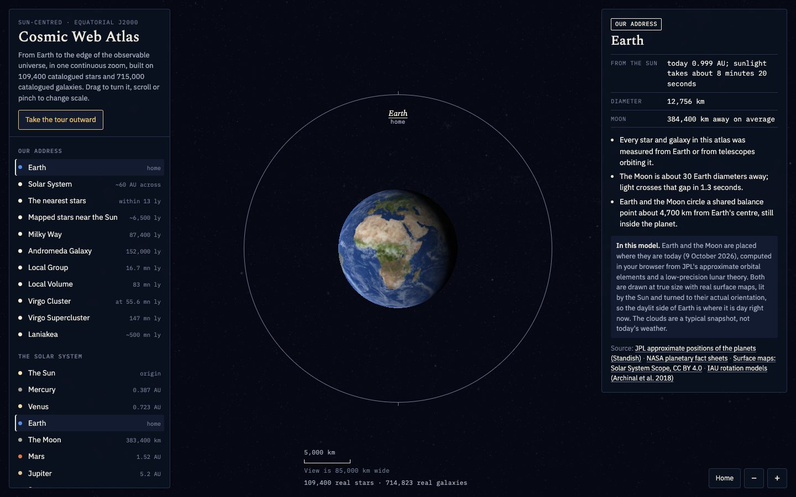
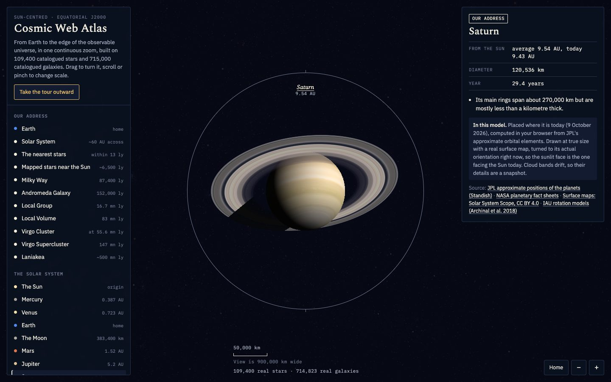
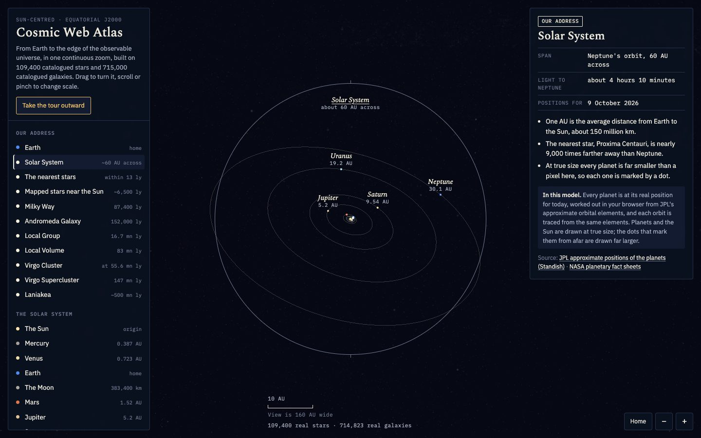
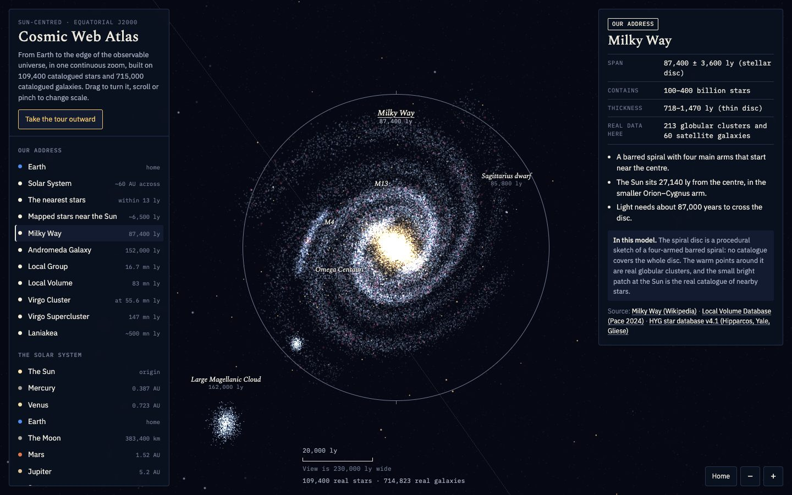
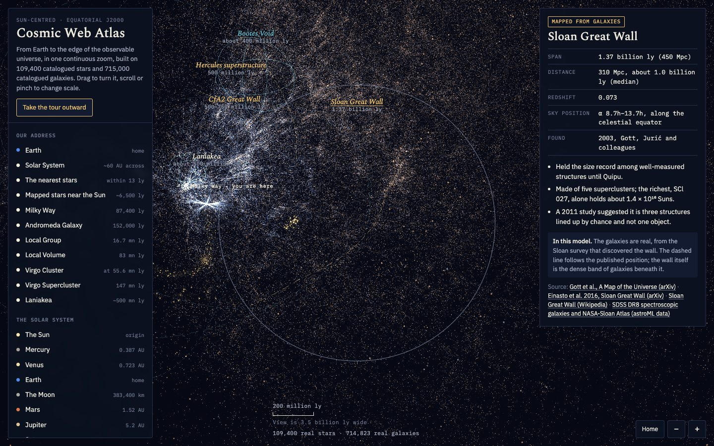
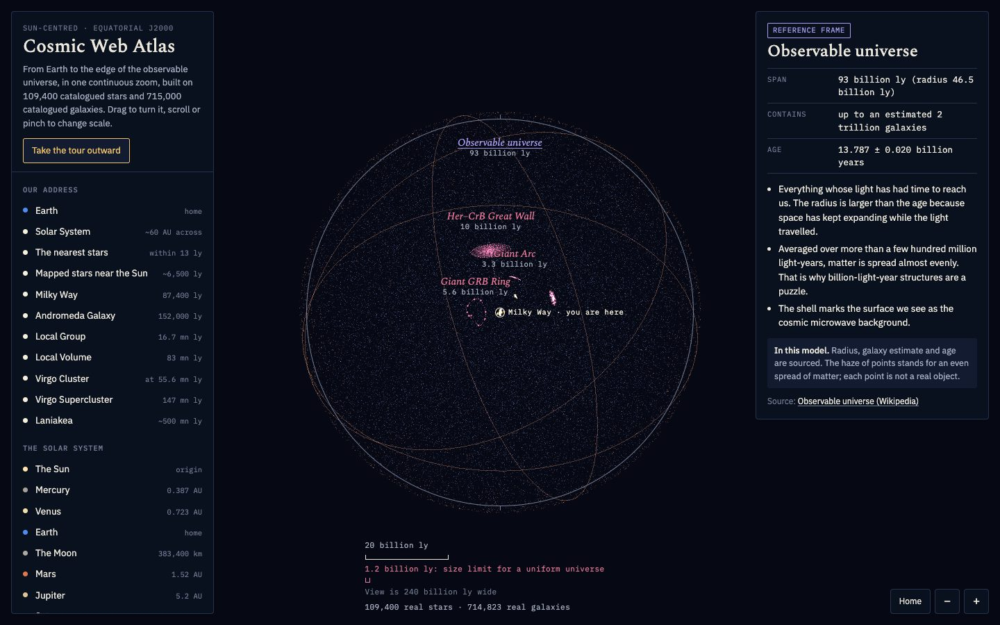

# Cosmic Web Atlas

A zoomable 3D map that runs in the browser, from Earth to the edge of the observable universe. It plots 109,400 real stars and about 715,000 real galaxies at their catalogued positions, and marks the largest known cosmic structures.



| | |
|---|---|
|  |  |
| **Saturn**, with the planet's shadow across its rings | **The Solar System**, every planet at today's position |
|  |  |
| **The Milky Way** and its real globular clusters | **The Sloan Great Wall** in 700,000 real galaxies |
|  | |
| **The observable universe**, 93 billion light-years across | |

## Run it

The page loads its data files with `fetch`, which browsers block on `file://` URLs, so opening `index.html` by double-click shows the map without the star and galaxy catalogues. Serve the folder over HTTP instead:

```bash
git clone https://github.com/Samyak-jain7/cosmic-web-atlas.git
cd cosmic-web-atlas
python3 -m http.server 8000
```

Then open <http://localhost:8000> in Chrome, Safari, or Firefox. Stop the server with `Ctrl+C`.

Any static file server works. For example, `npx serve .` does the same job.

Requirements:

| Need | Detail |
|---|---|
| Browser | Any current browser with WebGL enabled |
| Python 3 | Only for the one-line web server above; macOS ships with it |
| Internet | Not needed to run. Only the two web fonts load from Google Fonts, and the page falls back to system fonts without them |

The catalogues are about 9 MB, so the first load takes a few seconds. The status line under the scale bar reads "109,400 real stars · 714,823 real galaxies" once they are in.

## Use it

| Action | How |
|---|---|
| Rotate | Drag |
| Zoom | Scroll or pinch; `+` and `-` keys; the buttons at bottom right |
| Jump to a structure | Click it in the left-hand list, or click its label on the map |
| Guided tour | "Take the tour outward": twelve steps from Earth to the whole observable universe |
| Hide everything drawn | Turn off "Sketches" under Layers to see measured data alone |
| Return home | "Home" button flies back to the Milky Way |

Each card ends with an "In this model" note saying what is real catalogue data and what is drawn from published dimensions.

## What is real and what is drawn

| Layer | Status |
|---|---|
| Sun, planets and Moon | Real positions for the day you open the page, computed from JPL's approximate orbital elements (valid 1800–2050) and a low-precision lunar formula; drawn at true size, colours sketched |
| Stars near the Sun (109,400) | Real, from the HYG database |
| Globular clusters (213) and nearby galaxies (911) | Real, from the Local Volume Database |
| NGC and IC galaxies (9,833) | Real directions and redshifts, from OpenNGC |
| Sloan survey galaxies (704,990) | Real directions and redshifts, from SDSS DR8 and the NASA-Sloan Atlas |
| Milky Way disc; shapes of Andromeda, Triangulum, and the Magellanic Clouds | Sketches placed at measured positions |
| Quipu, Shapley, South Pole Wall, Perseus–Pisces, Sculptor–Pegasus, BOSS Great Wall | Gold sketches drawn from published sizes and sky positions |
| Giant Arc, Giant GRB Ring, Huge-LQG, Hercules–Corona Borealis Great Wall | Disputed claims, drawn from published dimensions |
| "Simulated web" layer (off by default) and the large-scale haze | Statistical illustration, not surveyed objects |

Two things to keep in mind when reading the map:

- Galaxy distances beyond about 41 million light-years come from redshift, so clusters look stretched toward the Sun.
- Directions with no galaxies were not observed by the surveys used here. They are not empty.

## Project layout

```
cosmic-web-atlas/
├── index.html              the whole app: markup, styles, and script
├── near.txt                stars and NGC/IC galaxies (base64-packed binary)
├── gal.txt                 Sloan survey galaxies (base64-packed binary)
├── vendor/
│   ├── three.min.js        three.js r128, the 3D library
│   ├── three.LICENSE
│   └── textures/           2k surface maps of the Sun, planets, Moon and Saturn's rings
├── docs/screenshots/       images used in this README
├── tools/
│   ├── fetch_catalogues.sh downloads the raw public catalogues
│   ├── build_data.py       turns them into near.txt and gal.txt
│   └── requirements.txt
└── README.md
```

Small catalogues (globular clusters, nearby galaxies, and the labelled objects) are embedded in `index.html` inside the `<script id="meta">` block.

## Rebuild the data (optional)

You only need this if you want to change which objects are included or how they are placed. The shipped `near.txt` and `gal.txt` are already built.

```bash
cd cosmic-web-atlas
python3 -m venv .venv && source .venv/bin/activate
pip install -r tools/requirements.txt
./tools/fetch_catalogues.sh      # about 190 MB into tools/raw/
python3 tools/build_data.py      # rewrites near.txt, gal.txt, and the meta block in index.html
```

The build is deterministic: with the same raw catalogues it reproduces the shipped files byte for byte.

Choices made in `build_data.py`:

| Choice | Value |
|---|---|
| Coordinates | Sun at the origin, equatorial J2000; units are millions of light-years |
| Redshift to distance | Comoving distance, flat cosmology with H0 = 67.8 and matter density 0.308 |
| Redshift frame | Corrected from the Sun's frame to the cosmic microwave background frame |
| Stars kept | Those with a valid measured distance (HYG marks unknown distances as 100,000 pc) |
| NGC/IC galaxies kept | Redshift above 0.002; closer ones are covered by the Local Volume Database |
| Virgo Cluster members | Placed at the cluster's measured distance of 55.6 million light-years |
| Sloan galaxies kept | NASA-Sloan Atlas below redshift 0.05; SDSS DR8 from 0.05 to 0.5 with redshift error under 0.002 |

## Data sources

| Catalogue | Link |
|---|---|
| HYG star database v4.1 | <https://github.com/astronexus/HYG-Database> |
| Local Volume Database | <https://github.com/apace7/local_volume_database> |
| OpenNGC | <https://github.com/mattiaverga/OpenNGC> |
| SDSS DR8 spectroscopic galaxies and NASA-Sloan Atlas, via astroML data | <https://github.com/astroML/astroML-data> |

Sizes, distances, and sky positions for the named structures come from the papers and reference pages linked on each card inside the app.

Surface maps in `vendor/textures/` are from [Solar System Scope](https://www.solarsystemscope.com/textures/), based on NASA mission imagery, licensed CC BY 4.0. Each body is turned to its real orientation using the IAU rotation models (Archinal et al. 2018).

Each catalogue has its own licence and citation terms. Check them before redistributing the data files.

## Known limits

- Tested in a headless Chromium browser at desktop and phone sizes. It has not been tested on a physical phone.
- On narrow screens only half of the Sloan galaxies are drawn, to keep the frame rate up.
- A published copy of this atlas also exists as a private Claude artifact. That copy loads three.js from a CDN; this folder uses the local copy in `vendor/`.
